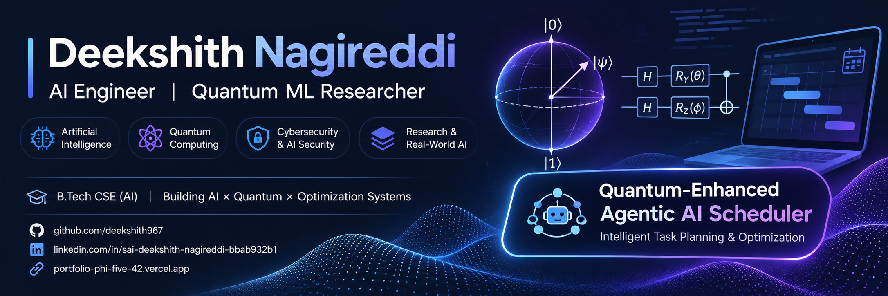

  

# Hi, I'm Deekshith Nagireddi

### AI Engineer | Quantum ML Researcher | Software Developer

  
  
  
  

---

## About Me

I'm an Integrated Dual Degree student in Computer Science and Engineering (AI) at **RGIPT**, interested in building intelligent systems, AI applications, and scalable software.

- Research experience at **IIT (BHU), Varanasi** in Quantum Computing and Machine Learning.
- Exploring **Agentic AI, Generative AI, Quantum Machine Learning, and Distributed Systems**.
- Building full-stack AI applications and backend infrastructure.
- Interested in research-driven engineering and practical AI systems.

---

## Tech Stack

### Languages

### AI / Machine Learning

### Quantum Computing

### Backend / Database / Tools

---

## Featured Projects

### 1. Quantum-Enhanced Agentic AI for Intelligent Task Planning

**Thesis Research Project**

An agentic AI system for intelligent task planning and resource optimization using hybrid quantum-classical optimization.

- Agentic AI workflow with RAG and ReAct.
- QUBO/Ising formulation for optimization.
- QAOA simulation and classical CP-SAT comparison.
- Constraint verification, fallback strategies, and human-in-the-loop workflows.

`Python` `Qiskit` `QAOA` `OR-Tools` `FastAPI`

[View Repository](https://github.com/deekshith967/quantum-agentic-scheduler)

---

### 2. NexusFlow — Distributed Workflow Orchestration Engine

A distributed workflow engine designed for reliable execution of dependency-driven tasks.

- DAG-based workflow orchestration.
- Concurrent workers and PostgreSQL-based task coordination.
- Kafka transactional outbox and event-driven processing.
- Idempotency, retries, crash recovery, and tenant isolation.
- 161 passing tests across 18 Jest suites.

`TypeScript` `NestJS` `PostgreSQL` `Kafka` `Jest`

---

### 3. AI Financial Research Copilot

An AI-powered financial research assistant integrating agentic workflows and retrieval-augmented generation.

- 15+ financial research tools.
- LangChain and LangGraph agent workflows.
- Local RAG pipeline and streaming responses.
- Evaluation and observability with Langfuse.
- 138 tests.

`Python` `LangChain` `LangGraph` `FastAPI` `React` `Langfuse`

---

### 4. FinVision AI — Full-Stack Finance Platform

An AI-powered finance application for transaction tracking and intelligent financial insights.

- Authentication and role-based access control.
- Transaction dashboards and receipt scanning.
- AI-powered transaction categorization and insights.
- Full-stack application with database integration.

`Next.js` `Supabase` `Prisma` `PostgreSQL` `Gemini API`

---

## Research Experience

### Research Intern — IIT (BHU), Varanasi
**Quantum Computing and Machine Learning Lab | May – August 2025**

- Developed machine learning pipelines for S&P 500 time-series forecasting.
- Benchmarked LSTM, GRU, and Linear Regression models.
- Explored hybrid quantum-classical machine learning using PyQPanda, PyVQNet, and QTensor.
- Worked on quantum autoencoders for feature compression and reproducibility.

---

## Achievements

- Finalist — Binary Clash 360 Hackathon, IIT Madras (2024).
- Solved 150+ problems on LeetCode.
- Certified Cyber Warrior — HackingFlix Academy.

---

## GitHub Statistics

  
  

  

---

## Contribution Activity

  <picture>
    <source media="(prefers-color-scheme: dark)" srcset="https://raw.githubusercontent.com/deekshith967/deekshith967/output/github-contribution-grid-snake-dark.svg">
    <source media="(prefers-color-scheme: light)" srcset="https://raw.githubusercontent.com/deekshith967/deekshith967/output/github-contribution-grid-snake.svg">
    
  </picture>

---

## Connect With Me

  
  
  

  <i>Building intelligent systems at the intersection of AI, quantum computing, and software engineering.</i>

